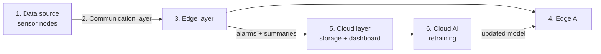

# WildfireSense

Early wildfire detection with edge intelligence. Course project for **IoT and V2X** (Universidad de Málaga, 2026/27), **Track A: IoT with edge intelligence**.

> Status: design phase. See [docs/00-guidelines-map.md](docs/00-guidelines-map.md) for what is done and what is pending.

## Problem
Detect a wildfire early in a remote area with low-power sensor nodes, a constrained uplink and a cloud that may be unreachable. The alarm must be decided locally (edge), and only what is needed must travel to the cloud.

## Architecture (Track A, six logical components)



| # | Component | Folder | Technology (proposed, see `docs/decisions/`) |
|---|---|---|---|
| 1 | Data source | `src/datasource/` | Python replay/generator |
| 2 | Communication layer | `infra/mosquitto/` | MQTT (Eclipse Mosquitto) |
| 3 | Edge layer | `src/edge/` | Python service in a resource-limited container |
| 4 | Edge AI | `src/edge_ai/`, `ml/` | scikit-learn (offline training, local inference) |
| 5 | Cloud layer | `src/cloud/`, `infra/grafana/` | InfluxDB + Grafana |
| 6 | Cloud AI | `src/cloud_ai/` | Scheduled retraining, model pushed back to the edge |

## Repository layout

```
docs/          requirements, system model, architecture, contract, decisions (ADRs), meeting minutes
src/           source code, one folder per logical component
ml/            training notebooks and exported models
data/          datasets (raw = never edited, processed = generated); see data/README.md
experiments/   evaluation protocol and results (E1..E4)
infra/         configuration of third-party services
tests/         automated tests
.github/       issue/PR templates and CI
```

## Quick start
> To be completed as components land. Target: the whole system must start with one command.

```bash
cp .env.example .env
docker compose up -d
```

Reproducing results: see [experiments/README.md](experiments/README.md).

## Team
| Name | GitHub | Pair |
|---|---|---|
| Joan | _(fill in)_ | A |
| Lola | _(fill in)_ | A |
| Abel | _(fill in)_ | B |
| Yousuf | _(fill in)_ | B |

Weekly rotating roles (chair, secretary): [docs/meetings/README.md](docs/meetings/README.md).
How we work: [CONTRIBUTING.md](CONTRIBUTING.md). Who did what: [CONTRIBUTIONS.md](CONTRIBUTIONS.md).

## Data and licences
Every dataset, its source, licence and use is listed in [data/README.md](data/README.md).
