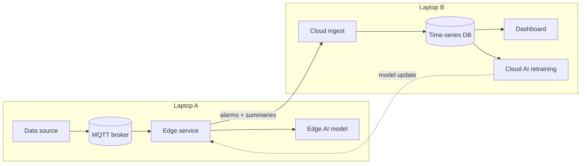

# Architecture

_(Adjust to the real deployment: which component runs on which machine, ports, network.)_

## Components
For each of the six components: responsibility, inputs/outputs, technology, resource limits, owner. Link to its `src/<component>/README.md`.

## Deployment
Machines, containers, resource limits, ports, network assumptions.

## Failure behaviour
What happens if the cloud is unreachable, the broker restarts, or a node goes silent.
